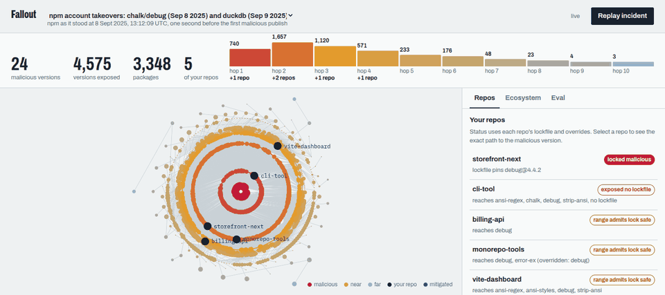
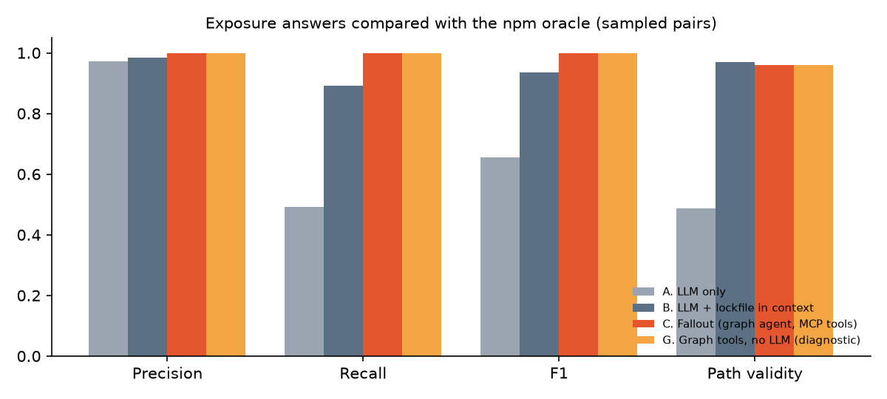
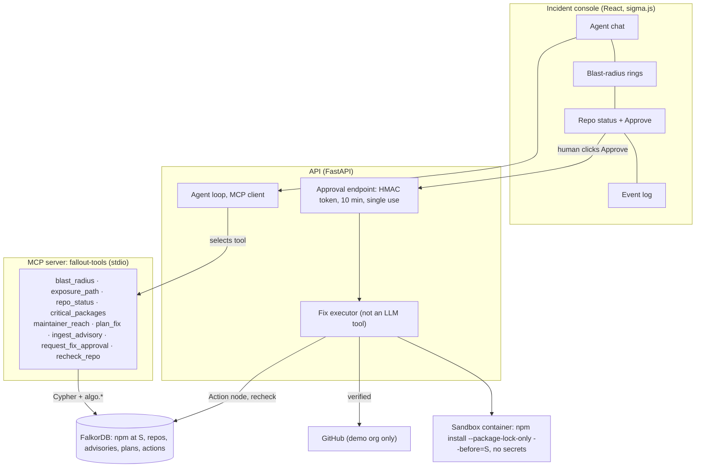

# Fallout



On 8 September 2025 an attacker phished an npm maintainer and published malware in `chalk`,
`debug` and 17 other packages, which together see billions of downloads a week. Every team had
the same three questions: are we affected, through what, and what do we change? Fallout answers
them from a graph. It loads the npm dependency graph as it stood one second before the first
malicious publish into FalkorDB, walks out from the malicious versions hop by hop, classifies
each of your repos using its lockfile and overrides, and shows the exact path with the semver
requirement on every hop. When you approve a fix, it regenerates the lockfile in a sandbox with
no secrets, verifies the malware is gone, and opens the pull request.

Built for Graph Hacks (FalkorDB), October 2026. Demo video: a captioned recording of the console
(`docs/media/fallout-demo.webm`, recorded with Playwright; not in git, uploaded separately).

## Results

300 sampled questions of the form *"as of S, is target X exposed to advisory set Y, and through
which path?"*. The questions span 13 advisory sets (the chalk/debug and duckdb batches, part of the
Shai-Hulud worm, older malware such as `ua-parser-js` and `event-stream`, and seven high-severity
vulnerabilities) and 506 targets. Ground truth is npm's own resolver: `@npmcli/arborist`
builds each target's ideal tree at S, and the oracle never reads FalkorDB. All LLM systems use
`gpt-6-luna` with the same question and answer schema.

| System | Precision | Recall | F1 | Made-up nodes | Made-up edges | Valid paths | p50 | p95 | Cost / question |
|---|---|---|---|---|---|---|---|---|---|
| A. LLM only | 0.973 | 0.493 | 0.655 | 10.9% | 38.2% | 48.6% | 5.4 s | 17.5 s | $0.00025 |
| B. LLM + the full lockfile in context | 0.985 | 0.890 | 0.935 | 0.0% | 0.4% | 97.0% | 3.1 s | 7.6 s | $0.00014 |
| **C. Fallout (agent + MCP tools on FalkorDB)** | **1.000** | **1.000** | **1.000** | **0.0%** | 2.6% | 95.9% | 3.5 s | 4.5 s | $0.00014 |
| G. Fallout's graph tools alone, no LLM | 1.000 | 1.000 | 1.000 | 0.0% | 2.5% | 95.9% | 3 ms | 24 ms | — |



What the numbers say, and what they don't:

- **The LLM alone misses half of the exposed targets** and invents one cited package version in
  ten. Handing it the lockfile (B) is a strong baseline, and it still misses 1 exposure in 10.
- **Fallout finds every exposure and invents no package version.** Its 2.6% of edges missing
  from npm's tree all come from one known approximation: a peer dependency is resolved on its own,
  while npm reuses the version already installed (limitation 9). In those cases the verdict is
  right but one hop names a different version than npm would install.
- **G matches C**, so the agent adds no error on top of the graph.
- **The sample is 24% positive, not the 40% planned.** By September 2025 most popular packages
  had moved past the older vulnerable versions, so 68 of the 73 exposed pairs come from
  chalk/debug. The other units are mostly negatives, and they are where LLM-only guesses fail.
- Everything is in `eval/results.md`, every prompt and answer in `eval/runs/`. One instruction
  change and one grading convention were made after the first full run; both are documented with
  the earlier numbers in [docs/DECISIONS.md](docs/DECISIONS.md#eval-protocol-notes).

## What the replay shows

Replaying the chalk/debug incident against the six demo repos:

| Repo | Status | Why |
|---|---|---|
| storefront-next | `LOCKED_MALICIOUS` | its lockfile pins `debug@4.4.2` (a synthetic fixture: the real tarball is gone) |
| cli-tool | `EXPOSED_NO_LOCKFILE` | `chalk ^5.3.0` and `debug ^4.3.4` would pick the malicious releases on the next install |
| billing-api | `RANGE_ADMITS_LOCK_SAFE` | four hops: `@sentry/node` → `@opentelemetry/instrumentation` → `require-in-the-middle`, whose `^4.3.5` would pick `debug@4.4.2` |
| vite-dashboard, monorepo-tools | `RANGE_ADMITS_LOCK_SAFE` | safe lockfiles; monorepo-tools' override covers `debug` but not `error-ex` |
| notify-worker | `NOT_AFFECTED` | |

4,575 versions in 3,348 packages are exposed, out to hop 10. The traversal takes about 0.4 s.
Approving the fixes opened real pull requests in the demo org, each verified in the sandbox and
rechecked to `MITIGATED_BY_OVERRIDE`:
[billing-api#1](https://github.com/fallout-demo/billing-api/pull/1),
[cli-tool#1](https://github.com/fallout-demo/cli-tool/pull/1),
[storefront-next#1](https://github.com/fallout-demo/storefront-next/pull/1).

## How it works



**The anchor S.** S = `2025-09-08T13:12:09.343Z`, one second before `ansi-styles@6.2.2`, the first
malicious publish (from the npm registry's `time` field; `config/anchor.json`). Every version in
the graph was resolved by npm's own `npm-pick-manifest` with `before: S`, over 17,338 seed
packages (`npm-high-impact`) and their full closure: 34,018 versions, 21,010 packages and 114,810
resolved `DEPENDS_ON` edges, each carrying its declared range. The whole graph has 67k nodes and
360k edges. The malicious versions never existed at S, so they are injected from OSV.

**Exposure.** A target is exposed when the version npm *would pick* for some requirement on its
tree is an affected version. For malicious advisories that means resolving with the malicious
versions injected as of their publish time; for vulnerabilities, the version resolved at S is in
the affected range. This is stricter than "the range admits an affected version", which would
mark nearly everything exposed to any old vulnerability. For the chalk/debug replay the two rules
agree exactly: both give 790 edges.

**FalkorDB does the work:**
- `ingest_advisory` finds every edge into an affected package and writes `CAN_RESOLVE_TO` where npm
  would pick a bad version (790 edges for the replay).
- `blast_radius` is a reverse BFS driven hop by hop from Python over `DEPENDS_ON|DIRECT_DEP`,
  persisted as `EXPOSES {hop, via}` parent pointers.
- `exposure_path` walks those pointers and cross-checks them with `shortestPath`.
- `repo_status` combines `LOCKS`, `OVERRIDES` and the repo's resolved closure.
- `critical_packages` reads `algo.pageRank` and `algo.betweenness` (seeded sampling) computed over
  a `PKG_DEPENDS_ON` projection (80,465 edges).
- `maintainer_reach` is a reverse closure from each of the top 300 maintainer accounts.

Every query lives in `graph/queries/*.cypher`. Every tool returns
`{result, paths, cypher, timing_ms}`, and the agent must cite a returned `path_id` for every claim.

**Fixes.** `plan_fix` writes the smallest override that works: a selector override
`"debug@4.4.2": "4.4.1"`, which npm applies only to the edges whose range admits the malicious
version. It uses the highest safe version published before S, pins direct dependencies, and
falls back to scoped overrides when ranges conflict. The agent can only *request* approval. The
Approve button mints a 10-minute single-use HMAC token, which the API hands to the executor
directly, so the LLM never sees one. The executor then:

1. checks the repo against an allowlist,
2. regenerates the lockfile in a throwaway container with no tokens and `--ignore-scripts`,
3. asserts no affected version is locked,
4. opens the PR (body: advisory, graph paths, rationale, verification output),
5. records an `Action` node and rechecks the PR branch.

No MCP tool can write to GitHub, and a test asserts it.

## Run it

**From the snapshot (no crawl).** You need Docker and `.env` with `OPENAI_API_KEY`,
`FALLOUT_GH_TOKEN` (fine-grained, demo org only, contents + pull requests), `FALLOUT_CONSOLE_KEY`
and `FALLOUT_APPROVAL_SECRET`.

```bash
tar -xzf data/snapshots/fallout-data.tar.gz   # crawl resolutions + demo repo checkouts
docker compose build sandbox                  # the lockfile sandbox image
docker compose up -d                          # seed -> falkordb -> api
open http://127.0.0.1:8000                    # the console; approvals ask for FALLOUT_CONSOLE_KEY
```

`scripts/snapshot.sh` writes `data/snapshots/dump.rdb` and the tarball from a machine that has
the graph. The API mounts the Docker socket only so the executor can start the sandbox container.
Without `OPENAI_API_KEY`, the agent falls back to a scripted offline planner whose every answer is
labelled as such.

**Development.**

```bash
uv sync && (cd workers && npm ci) && (cd web && npm ci) && (cd eval/oracle && npm ci)
uv run uvicorn api.main:app --port 8000      # API + MCP server
(cd web && npm run dev)                      # console on :5173, proxied to the API
uv run python -m api.demo --no-approve       # the demo script, headless, end to end
uv run python -m api.demo --reset            # put the graph back on the repos' default branches
uv run pytest && uv run ruff check . && uv run mypy ingest fallout eval api mcp_server analysis
```

**From scratch.** Rebuilding the graph takes a few hours, most of it the polite, cached crawl of
deps.dev and the npm registry:

```bash
uv run python -m ingest.anchor && uv run python -m ingest.seed && uv run python -m ingest.repo_seeds
uv run python -m ingest.crawl && uv run python -m ingest.crawl_npm
uv run python -m ingest.load_graph && uv run python -m ingest.load_repos && uv run python -m ingest.project_packages
uv run python -m analysis.algorithms && uv run python -m fallout.advisory && uv run python -m fallout.blast
```

**The eval.** `eval.dataset` ingests the 13 units, runs the oracle on 506 targets (a few minutes)
and labels 6,461 pairs. `eval.sample` draws the stratified 300. `eval.run` asks systems A, B, C
and G and grades them, in about 9 minutes and $0.16. `--regrade RUN_ID` rescores a logged run
without calling the model.

```bash
uv run python -m eval.dataset && uv run python -m eval.sample && uv run python -m eval.run
```

## Limitations

The full list, with every deviation from the build spec, is in
[docs/DECISIONS.md](docs/DECISIONS.md).

- **`dist-tags.latest` at S is approximated** as the highest stable, non-deprecated version
  published at or before S. Deprecation flags are today's, not S's.
- **npm dedupe and hoisting are not modelled.** Each requirement resolves independently. Peer
  dependencies resolve on their own instead of reusing the installed version; this explains every
  invalid Fallout path in the eval.
- **Non-registry specs** (git, tarball, `file:`) and `bundleDependencies` are not followed.
- **Download counts are current**, used only for weighting and display.
- **`storefront-next`'s `LOCKED_MALICIOUS` lockfile is a synthetic fixture**, hand-edited to
  `debug@4.4.2`; the real tarball has been removed from npm.
- **Overrides change status, not resolution.** `DEPENDS_ON` is the un-overridden tree, and
  overrides are applied when computing status.
- **The seed set** is the 17k packages of `npm-high-impact`, not the whole registry.

## Ethics

Fallout uses only public metadata (the npm registry, deps.dev, OSV). It never downloads or runs
malicious code: malicious versions exist in the graph only as metadata, and the sandbox runs
`--package-lock-only --ignore-scripts`. Pull requests are opened only against repos in the
builder's own demo org, enforced by an allowlist in the executor and in the PR client; no PRs or
issues go to third-party repos. Maintainer reach measures how concentrated risk is in the
ecosystem. It says nothing about the people behind the accounts, and maintainer data stores
usernames only.

## Prior work

The ecosystem analysis is an updated, reproducible take on Zimmermann, Staicu, Tenny and Pradel,
*Small World with High Risks: A Study of Security Threats in the npm Ecosystem*
(USENIX Security 2019). The write-up is in [docs/blog.md](docs/blog.md).

## Layout

```
api/            FastAPI app, agent loop, approval, fix executor, GitHub PR client, demo script
mcp_server/     the MCP server (stdio)
fallout/        tools, blast radius, advisory ingest, fix planner, sandbox, LLM client
graph/queries/  every Cypher query
ingest/         anchor, seeds, time-anchored crawl, npm metadata, graph and repo loaders
analysis/       PageRank, betweenness, maintainer reach
workers/        npm-pick-manifest resolver, semver evaluator, sandbox image
eval/           oracle (arborist), dataset, sampler, runner, grader, results
web/            the incident console
docs/           BUILD.md (spec), DECISIONS.md (deviations), blog.md, media
```
