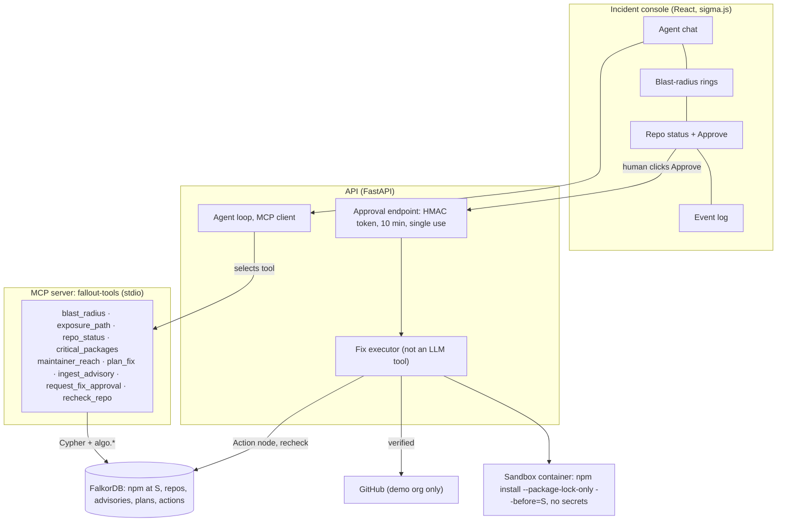

# Fallout


On 8 September 2025, an attacker phished an npm maintainer. The attacker then published malware
in `chalk`, `debug` and 17 other packages. Together, these packages get billions of downloads a
week. After an attack like this, a team must find out three things. Is the team affected? Through
which dependency? What change removes the malware?

Fallout answers these questions from a graph. It loads the npm dependency graph into FalkorDB as
it was one second before the first malicious publish. From the malicious versions, it walks the
graph one hop at a time. A hop is one dependency edge. Fallout classifies each of your repos from
its lockfile and its `overrides`. For each exposed repo, it shows the full path and the semver
range on each hop. When you approve a fix, Fallout regenerates the lockfile in a sandbox that has
no secrets. It verifies that the malware is gone, and then it opens a pull request (PR).

Built for Graph Hacks (FalkorDB), October 2026. Demo video: a captioned recording of the console
(`docs/media/fallout-demo.webm`, recorded with Playwright). The video is not in git. It is
uploaded separately.

## Results

The eval has 300 sampled questions of this form: *"as of S, is target X exposed to advisory group
Y, and through which path?"*. S is the snapshot time, described in [How it works](#how-it-works).
The questions cover 506 targets and 13 advisory groups:

- the chalk/debug and duckdb batches
- part of the Shai-Hulud worm
- older malicious packages, such as `ua-parser-js` and `event-stream`
- seven high-severity vulnerabilities

Ground truth comes from the oracle. The oracle is npm's own resolver, `@npmcli/arborist`, which
builds the ideal tree of each target at S. The oracle never reads FalkorDB. All LLM systems use
`gpt-6-luna` with the same question and the same answer schema.

| System | Precision | Recall | F1 | Hallucinated packages | Hallucinated edges | Path validity | p50 | p95 | Cost / question |
|---|---|---|---|---|---|---|---|---|---|
| A. LLM only | 0.973 | 0.493 | 0.655 | 10.9% | 38.2% | 48.6% | 5.4 s | 17.5 s | $0.00025 |
| B. LLM + the full lockfile in context | 0.985 | 0.890 | 0.935 | 0.0% | 0.4% | 97.0% | 3.1 s | 7.6 s | $0.00014 |
| **C. Fallout (agent + MCP tools on FalkorDB)** | **1.000** | **1.000** | **1.000** | **0.0%** | 2.6% | 95.9% | 3.5 s | 4.5 s | $0.00014 |
| G. Fallout's graph tools alone, no LLM | 1.000 | 1.000 | 1.000 | 0.0% | 2.5% | 95.9% | 3 ms | 24 ms | — |


Notes on the results:

- The LLM alone (A) misses half of the exposed targets. One in ten of the package versions that
  it cites does not exist. With the lockfile in context (B), the LLM is a strong baseline, but it
  still misses 1 exposure in 10.
- Fallout (C) finds every exposure and cites no hallucinated package version. 2.6% of its edges
  are not in npm's tree. All of these edges come from one known approximation. Fallout resolves a
  peer dependency on its own, but npm reuses the version that is already installed (limitation 9
  in [docs/DECISIONS.md](docs/DECISIONS.md)). In these cases the verdict is correct, but one hop
  names a different version than npm would install.
- G gives the same results as C. The agent adds no error to the graph results.
- The sample is 24% positive, not the planned 40%. By September 2025, most popular packages used
  versions newer than the older vulnerable versions. As a result, 68 of the 73 exposed pairs come from
  chalk/debug. The other advisory groups are mostly negatives, and all systems answer them
  correctly (System A has a precision of 0.973).
- `eval/results.md` has all the results, and `eval/runs/` has every prompt and answer. After the
  first full run, we changed one instruction and added one grading convention.
  [docs/DECISIONS.md](docs/DECISIONS.md#eval-protocol-notes) describes both changes and gives the
  earlier numbers.

## What the replay shows

This is the replay of the chalk/debug incident against the six demo repos:

| Repo | Status | Why |
|---|---|---|
| storefront-next | `LOCKED_MALICIOUS` | its lockfile pins `debug@4.4.2` (a synthetic fixture, because the real tarball is gone) |
| cli-tool | `EXPOSED_NO_LOCKFILE` | `chalk ^5.3.0` and `debug ^4.3.4` would pick the malicious releases on the next install |
| billing-api | `RANGE_ADMITS_LOCK_SAFE` | four hops: `@sentry/node` → `@opentelemetry/instrumentation` → `require-in-the-middle`, whose `^4.3.5` would pick `debug@4.4.2` |
| vite-dashboard, monorepo-tools | `RANGE_ADMITS_LOCK_SAFE` | safe lockfiles. The monorepo-tools override covers `debug` but not `error-ex` |
| notify-worker | `NOT_AFFECTED` | |

The blast radius is 4,575 versions in 3,348 packages, out to hop 10. The traversal takes
approximately 0.4 s. When we approved the fixes, Fallout opened real PRs in the demo org. The
sandbox verified each fix, and a recheck changed each repo to `MITIGATED_BY_OVERRIDE`:
[billing-api#1](https://github.com/fallout-demo/billing-api/pull/1),
[cli-tool#1](https://github.com/fallout-demo/cli-tool/pull/1),
[storefront-next#1](https://github.com/fallout-demo/storefront-next/pull/1).

## How it works



### Snapshot time (S)

S = `2025-09-08T13:12:09.343Z`. This is one second before `ansi-styles@6.2.2`, the first
malicious publish. The time comes from the `time` field in the npm registry and is stored in
`config/anchor.json`.

The crawl starts from 17,338 seed packages (`npm-high-impact`) and follows their full transitive
dependency tree. npm's own `npm-pick-manifest` resolves each version with `before: S`. The result
is 34,018 versions, 21,010 packages and 114,810 resolved `DEPENDS_ON` edges. Each edge has its
declared semver range. The full graph has 67k nodes and 360k edges. The malicious versions did
not exist at S, so Fallout adds them from OSV.

### Exposure

A target is exposed when npm *would pick* an affected version for a requirement in its dependency
tree:

- For a malicious package advisory, Fallout resolves with the malicious versions added at their
  publish times.
- For a CVE/GHSA advisory, the version that npm resolves at S is in the affected range.

This rule is stricter than "the range admits an affected version". The weaker rule marks almost
every target as exposed to any old vulnerability. For the chalk/debug replay, the two rules give
the same result: 790 edges.

### Graph queries in FalkorDB

- `ingest_advisory` finds each edge into an affected package. Where npm would pick a malicious
  version, it writes a `CAN_RESOLVE_TO` edge (790 edges for the replay).
- `blast_radius` is a reverse BFS over `DEPENDS_ON|DIRECT_DEP`. Python drives it one hop at a
  time and stores the result as `EXPOSES {hop, via}` parent pointers.
- `exposure_path` follows these pointers and cross-checks them with `shortestPath`.
- `repo_status` combines `LOCKS`, `OVERRIDES` and the resolved dependency tree of the repo.
- `critical_packages` finds the critical packages (high PageRank / betweenness centrality). It
  reads `algo.pageRank` and `algo.betweenness` (seeded sampling), computed over a
  `PKG_DEPENDS_ON` projection (80,465 edges).
- `maintainer_reach` finds all packages that transitively depend on the packages of each of the
  top 300 maintainer accounts.

All queries are in `graph/queries/*.cypher`. Each tool returns
`{result, paths, cypher, timing_ms}`. The agent must cite a returned `path_id` for each claim.

### Fixes

`plan_fix` writes the smallest override that removes the exposure. It uses a version-specific
override (an `overrides` key with a version, e.g. `"debug@4.4.2"`):
`"debug@4.4.2": "4.4.1"`. npm applies this override only to the edges whose range admits the
malicious version. The replacement is the highest safe version published before S. Direct
dependencies are pinned in the manifest instead. When ranges conflict, `plan_fix` uses nested
overrides.

The agent can only *request* approval. When a person clicks Approve, the API issues a 10-minute,
single-use HMAC token. The API gives the token directly to the executor, so the LLM never sees
it. The executor then does these steps:

1. Checks the repo against an allowlist.
2. Regenerates the lockfile in an ephemeral container with no tokens and `--ignore-scripts`.
3. Asserts that no affected version is locked.
4. Opens the PR. The PR body has the advisory, the graph paths, the rationale and the
   verification output.
5. Records an `Action` node and rechecks the PR branch.

No MCP tool can write to GitHub. A test asserts this.

## Run it

### From the snapshot (no crawl)

You need Docker and a `.env` file with these values:

- `OPENAI_API_KEY`
- `FALLOUT_GH_TOKEN` (fine-grained, demo org only, contents + pull requests)
- `FALLOUT_CONSOLE_KEY`
- `FALLOUT_APPROVAL_SECRET`

```bash
tar -xzf data/snapshots/fallout-data.tar.gz   # crawl resolutions + demo repo checkouts
docker compose build sandbox                  # the lockfile sandbox image
docker compose up -d                          # seed -> falkordb -> api
open http://127.0.0.1:8000                    # the console; approvals ask for FALLOUT_CONSOLE_KEY
```

`scripts/snapshot.sh` writes `data/snapshots/dump.rdb` and the tarball. Run it on a machine that
has the graph. The API mounts the Docker socket only so that the executor can start the sandbox
container. If `OPENAI_API_KEY` is not set, the agent uses a scripted offline planner. Each answer
from the offline planner has a label that says so.

### Development

```bash
uv sync && (cd workers && npm ci) && (cd web && npm ci) && (cd eval/oracle && npm ci)
uv run uvicorn api.main:app --port 8000      # API + MCP server
(cd web && npm run dev)                      # console on :5173, proxied to the API
uv run python -m api.demo --no-approve       # the demo script, headless, end to end
uv run python -m api.demo --reset            # put the graph back on the repos' default branches
uv run pytest && uv run ruff check . && uv run mypy ingest fallout eval api mcp_server analysis
```

### From scratch

A full rebuild of the graph takes a few hours. Most of this time is the crawl of deps.dev and the
npm registry, which is rate-limited and cached:

```bash
uv run python -m ingest.anchor && uv run python -m ingest.seed && uv run python -m ingest.repo_seeds
uv run python -m ingest.crawl && uv run python -m ingest.crawl_npm
uv run python -m ingest.load_graph && uv run python -m ingest.load_repos && uv run python -m ingest.project_packages
uv run python -m analysis.algorithms && uv run python -m fallout.advisory && uv run python -m fallout.blast
```

### The eval

- `eval.dataset` ingests the 13 advisory groups and runs the oracle on 506 targets (a few
  minutes). It labels 6,461 pairs.
- `eval.sample` draws the stratified sample of 300.
- `eval.run` asks systems A, B, C and G and grades their answers. A run takes approximately 9
  minutes and costs $0.16.
- `--regrade RUN_ID` scores a logged run again without calls to the model.

```bash
uv run python -m eval.dataset && uv run python -m eval.sample && uv run python -m eval.run
```

## Limitations

[docs/DECISIONS.md](docs/DECISIONS.md) has the full list and all deviations from the build spec.

- Fallout approximates `dist-tags.latest` at S as the highest stable, non-deprecated version
  published at or before S. The deprecation flags are from today, not from S.
- Fallout does not model npm dedupe and hoisting. Each requirement resolves independently. A peer
  dependency resolves on its own, but npm reuses the installed version. This causes every invalid
  Fallout path in the eval.
- Fallout does not follow non-registry specs (git, tarball, `file:`) or `bundleDependencies`.
- Download counts are from today. Fallout uses them only for weighting and display.
- The `LOCKED_MALICIOUS` lockfile of `storefront-next` is a synthetic fixture. We edited it by
  hand to `debug@4.4.2`, because npm has removed the real tarball.
- Overrides change the status, not the resolution. `DEPENDS_ON` is the dependency tree without
  overrides. Fallout applies overrides when it calculates the status.
- The seed set is the 17k packages of `npm-high-impact`, not the full registry.

## Ethics

Fallout uses only public metadata from the npm registry, deps.dev and OSV. It never downloads or
runs malicious code. Malicious versions are in the graph only as metadata, and the sandbox runs
`--package-lock-only --ignore-scripts`. Fallout opens PRs only against repos in the builder's own
demo org. An allowlist in the executor and in the PR client enforces this. Fallout sends no PRs
or issues to third-party repos.

Maintainer reach measures how much risk is concentrated in a small number of accounts. It does
not measure the people who own the accounts. The maintainer data has usernames only.

## Prior work

The ecosystem analysis updates Zimmermann, Staicu, Tenny and Pradel, *Small World with High
Risks: A Study of Security Threats in the npm Ecosystem* (USENIX Security 2019), on a graph that
you can reproduce. [docs/blog.md](docs/blog.md) has the write-up.

## Layout

```
api/            FastAPI app, agent loop, approval, fix executor, GitHub PR client, demo script
mcp_server/     the MCP server (stdio)
fallout/        tools, blast radius, advisory ingest, fix planner, sandbox, LLM client
graph/queries/  every Cypher query
ingest/         anchor, seeds, time-anchored crawl, npm metadata, graph and repo loaders
analysis/       PageRank, betweenness, maintainer reach
workers/        npm-pick-manifest resolver, semver evaluator, sandbox image
eval/           oracle (arborist), dataset, sampler, runner, grader, results
web/            the incident console
docs/           BUILD.md (spec), DECISIONS.md (deviations), blog.md, media
```
