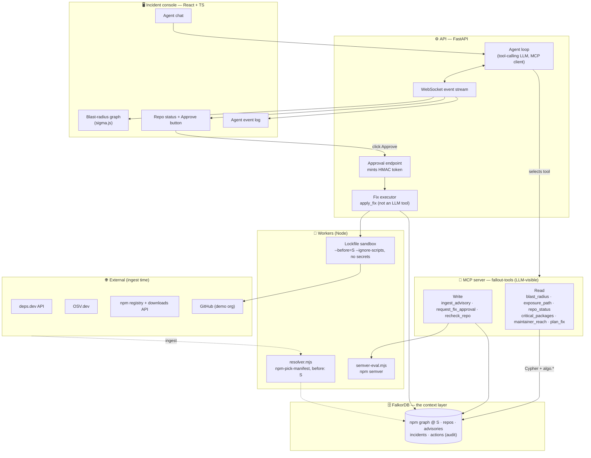

# Fallout — Build Specification (v2)

> **When a package is compromised, Fallout tells you who gets hit, shows the exact dependency path, and opens the fix PR.**
> A graph-grounded supply-chain incident agent on FalkorDB. Built for **Graph Hacks (WeMakeDevs × FalkorDB), Oct 15–18 2026**, Track 01 — *Agents That Act on Connected Data*.

This is the complete handoff for a coding agent. Build to it as written.
- **MUST** = maps to a judging criterion or a hiring signal. Do not drop it.
- **VERIFY** = an external detail (API shape, option name) to confirm on Day 1 before building on it.
- Every number in the README (recall, latency, counts) **MUST be produced by code in this repo. Never estimate, hardcode, or let an LLM write a metric.**

### What changed in v2 (review fixes)
| # | Problem in v1 | v2 fix | Section |
|---|---|---|---|
| 1–2 | deps.dev resolves against today's registry and gives no publish times for transitive nodes; a `published_at < T0` filter would shrink the blast radius | **One time anchor `S`.** Fallout resolves the graph itself, at `S`, using npm's own `npm-pick-manifest` with `before: S`. No node in the graph is newer than `S`. The BFS time filter is removed. | §5.0, §5.2 |
| 3 | Demo repo dependencies might never be crawled | Repo direct dependencies are seeds for the crawler | §5.5 |
| 4 | `recheck_repo` could never reach a clean status after an `overrides` fix | `OVERRIDES` edges in the graph, plus a new `MITIGATED_BY_OVERRIDE` status | §4.2, §7.5 |
| 5 | Oracle and lockfiles resolved against today | Graph, oracle and demo lockfiles all anchored at `S` | §5.0, §5.4, §8 |
| 6 | `Repo.status` overwritten across incidents | Status lives on the `(Incident)-[:EXPOSES]->(Repo)` edge | §4, §7.5 |
| 7 | VULN advisories explode `CAN_RESOLVE_TO` edges | One edge per dependent per affected package | §7.2 |
| 8 | Old incidents don't fit a 2025 graph | Every eval question is "exposed as of `S`" | §8 |
| 9 | Eval too large and unbalanced; baseline B and the hallucination check were undefined | Stratified ~300-pair sample, `--full` flag, defined B input, independent hallucination check | §8 |
| 10 | Approval token path undefined | HMAC token minted only by the Approve button; `apply_fix` is not an LLM tool | §6.3 |
| 11 | Null entries in a `collect`; wrong location for this file in the layout | Fixed | §7.5, §13 |

---

## 0. Constraints (read first)

| Constraint | Consequence for the build |
|---|---|
| FalkorDB must be the primary DB and central to the product | Every exposure answer, path and ranking comes from a FalkorDB query. The LLM never decides exposure from its own knowledge. |
| Submission and main FalkorDB work must be new during the event (Oct 15 00:01 – Oct 18 23:59 IST) | Fresh repo. Reuse only libraries and public datasets. |
| Live deploy preferred; otherwise local setup plus a demo video | Docker Compose on the VPS, plus a 3-minute video. |
| Track 01: multi-hop reasoning, graph queries/algorithms as tools, tool selection via MCP, actions, explainable results | The §6 tools and §10 demo are built around exactly these five. |
| Timebox ≈ 3.5 days | Build a small trusted core first. The eval harness is non-negotiable; UI polish is the first thing to cut. |

**Ethics rules (MUST; state them in the README):**
- Only public metadata is used.
- No malicious code is downloaded or executed.
- PRs are opened **only** against repos in the builder's own demo GitHub org. Never open PRs or issues on third-party repos.
- Maintainer analysis is presented as ecosystem concentration risk, not as criticism of individuals.

---

## 1. The product in one paragraph

On **8 September 2025**, attackers phished an npm maintainer account and published malicious versions of `chalk`, `debug` and 17 other packages, which together have billions of weekly downloads. A second account pushed malicious `duckdb` versions the next day. In incidents like this every engineering team asks: *are we affected, through what, and what do we change?*

Fallout loads the npm dependency graph as it stood just before the attack into FalkorDB, together with a set of application repos. The graph holds packages, versions, resolved dependency edges with their semver requirements, maintainers and advisories. Given an advisory, Fallout:
- computes the **blast radius** by traversing from the malicious versions to every package and repo whose requirements admit them,
- classifies each repo using its **lockfile and overrides**,
- shows the **exact path, with the semver requirement on every hop**,
- ranks what to fix first,
- after human approval, **opens a pull request** that pins a safe version, regenerates the lockfile in a sandbox, verifies the malicious version is gone, and records the action in the graph.

### The three proof points (what makes it stand out)
1. **Incident replay:** the demo replays the real Sep 8 2025 attack against the ecosystem graph as of that moment, end to end, in seconds.
2. **Measured ablation:** an eval harness scores three systems against an **independent, npm-authoritative oracle** on precision, recall, hallucinated-edge rate, latency and cost:
   - *LLM only*
   - *LLM + full lockfile in context*
   - *Fallout (graph agent)*
3. **Ecosystem finding:** PageRank and betweenness over the package graph, plus a maintainer-reach analysis. This is an updated, reproducible take on Zimmermann et al., *Small World with High Risks: A Study of Security Threats in the npm Ecosystem* (USENIX Security 2019), and it becomes the blog post.

---

## 2. Architecture



**Request flow:**
1. A user question goes to the agent loop.
2. The LLM selects an MCP tool.
3. The tool runs Cypher or `algo.*` against FalkorDB.
4. It returns `{result, paths, cypher, timing_ms}`.
5. The agent answers, **citing path IDs only from tool output**.
6. The frontend highlights those paths.

Writes to GitHub happen only through the Approve button → API → fix executor. The LLM can *request* approval but never holds or forwards a token.

---

## 3. Stack

| Layer | Choice | Why |
|---|---|---|
| Graph DB | FalkorDB (`falkordb/falkordb:latest`) | Required. Version-level graph of ~10⁵–10⁶ elements; fast traversals; built-in PageRank, betweenness and BFS. |
| Python client | `falkordb` (falkordb-py) | Parameterized Cypher, batched `UNWIND` loads. |
| Ingest | Python 3.12, `httpx` (async), `tenacity`, on-disk JSON cache | Resumable, polite crawl. |
| Resolution | **`workers/resolver.mjs`: `npm-pick-manifest` with `before: S`** over packuments synthesized from deps.dev data | Picks versions the way npm does (dist-tag preference, deprecated ranking, `before` cutoff). |
| Semver | `workers/semver-eval.mjs`: npm's `semver` (JSONL in, JSONL out) | Authoritative range semantics. |
| Agent | Hand-written tool-calling loop (any tool-calling LLM, e.g. Claude via the Anthropic API) plus the official `mcp` Python SDK as client | Transparent and loggable. |
| Tools | `mcp` Python SDK (FastMCP), stdio | "Tool selection through MCP" is literal. The same server plugs into any MCP client (Claude Desktop, Claude Code) for read-only use. |
| API | FastAPI + WebSockets | Streams agent events; hosts the approval endpoint and the fix executor. |
| Frontend | React + Vite + TypeScript, `sigma.js` + `graphology`, Tailwind | WebGL graph that stays smooth with thousands of nodes. |
| Sandbox | Node 22 container; `npm install --package-lock-only --ignore-scripts --before=<S>`; no secrets mounted | Safe, time-anchored lockfile regeneration. |
| Oracle (eval) | Node + `@npmcli/arborist` (`buildIdealTree`, `before: S`) + `semver` | Independent, npm-authoritative ground truth. |
| Quality | `pytest`, `ruff`, `mypy` (lenient), GitHub Actions CI | Visible SWE hygiene. |
| Deploy | Docker Compose on VPS; FalkorDB data volume pre-seeded from a snapshot | Deploy never re-crawls. |

---

## 4. Graph schema

### 4.1 Nodes

| Label | Key | Properties |
|---|---|---|
| `Package` | `name` | `weekly_downloads`, `maintainer_count`, `has_provenance` (bool, version at S), `pagerank`, `betweenness` |
| `Version` | `key` = `npm:<name>@<version>` | `name`, `version`, `published_at` (epoch ms, always ≤ S unless `is_malicious`), `is_malicious` (bool), `deprecated` (bool) |
| `Maintainer` | `name` (npm username) | `package_count`, `reach_packages`, `reach_downloads` (precomputed, §7.7) |
| `Advisory` | `id` (OSV id: `MAL-…`, `GHSA-…`) | `kind` (`MALICIOUS` / `VULN`), `summary`, `published_at`, `severity`, `url` |
| `Incident` | `id` (e.g. `npm-2025-09-08-chalk-debug`) | `title`, `started_at` (= T0), `status` |
| `Repo` | `key` = `repo:<org>/<name>` | `full_name`, `default_branch`, `has_lockfile`, `lockfile_version`, `head_sha` (no per-incident status here) |
| `Action` | `id` | `type` (`OPEN_PR`), `created_at`, `approved_by`, `plan_id`, `pr_url`, `verification` (JSON string), `result` |

### 4.2 Relationships

| Pattern | Properties | Notes |
|---|---|---|
| `(Package)-[:HAS_VERSION]->(Version)` | | |
| `(Version)-[:DEPENDS_ON]->(Version)` | `requirement`, `kind` (`prod`/`optional`/`peer`) | Resolved **by Fallout at S** (§5.2). `requirement` is the declared range. |
| `(Package)-[:PKG_DEPENDS_ON]->(Package)` | | Package-level projection used by the algorithms (§7.6). |
| `(Maintainer)-[:MAINTAINS]->(Package)` | | From the npm registry. |
| `(Maintainer)-[:PUBLISHED]->(Version)` | | `_npmUser` of the version, when available. |
| `(Advisory)-[:AFFECTS]->(Version)` | | Concrete affected versions from OSV. Malicious versions are created as nodes (§5.3). |
| `(Incident)-[:INCLUDES]->(Advisory)` | | |
| `(Version\|Repo)-[:CAN_RESOLVE_TO]->(Version)` | `incident`, `requirement` | **One edge per dependent per affected package**, pointing to the highest affected version the requirement admits (§7.2). |
| `(Incident)-[:EXPOSES]->(Version)` | `hop`, `via` | Persisted BFS result. |
| `(Incident)-[:EXPOSES]->(Repo)` | `hop`, `via`, **`status`**, `status_updated_at` | Per-incident repo status lives here. No edge means `NOT_AFFECTED`. |
| `(Repo)-[:DIRECT_DEP]->(Version)` | `requirement`, `scope` (`prod`/`dev`) | From `package.json`, resolved at S. |
| `(Repo)-[:LOCKS]->(Version)` | `path` (e.g. `node_modules/a/node_modules/debug`) | From `package-lock.json`. Replaced on every re-parse. |
| `(Repo)-[:OVERRIDES]->(Package)` | `spec`, `parent` (null for a global override, otherwise the scoping package name), `resolved_version` | From `package.json` `overrides`. Replaced on every re-parse. |
| `(Action)-[:ON]->(Repo)`, `(Action)-[:REMEDIATES]->(Incident)` | | Audit trail: every write, who approved it, what was verified. |

### 4.3 Indexes (create before loading)
```cypher
CREATE INDEX FOR (p:Package) ON (p.name);
CREATE INDEX FOR (v:Version) ON (v.key);
CREATE INDEX FOR (v:Version) ON (v.name);
CREATE INDEX FOR (m:Maintainer) ON (m.name);
CREATE INDEX FOR (a:Advisory) ON (a.id);
CREATE INDEX FOR (i:Incident) ON (i.id);
CREATE INDEX FOR (r:Repo) ON (r.key);
```

### 4.4 FalkorDB Cypher notes (VERIFY on Day 1 in FalkorDB Browser)
- Do **not** use `EXISTS { … }` subqueries. Use pattern predicates in `WHERE` (`NOT (a)-[:X]->(b)`) and pattern comprehensions.
- `exists()` checks properties only.
- `shortestPath()` needs both endpoints bound and no property filters inside the pattern. For filtered or weighted paths, use `algo.SPpaths({sourceNode, targetNode, relTypes, relDirection, maxLen, pathCount})`.
- `algo.pageRank(label, relType)` yields `node, score`. It is directed and scores by incoming edges.
- `algo.betweenness({nodeLabels, relationshipTypes, samplingSize, samplingSeed})` yields `node, score`. Always set `samplingSeed` so results are reproducible.
- Never write an unlabeled `MATCH (n {key: …})`; always include the label so the index is used.

---

## 5. Data and ingestion

All raw downloads go in `data/raw/`, which is gitignored and treated as untrusted input. Scripts live elsewhere and receive paths as arguments. All HTTP responses are cached in `data/cache/`, keyed by URL hash, so every stage is resumable and re-runs cost nothing.

### 5.0 The time anchor `S` (MUST; one value, used everywhere)
`S` = the earliest `published_at` among the replay incident's malicious versions, **minus 1 second**. It is taken from the npm registry `time` field or OSV, never typed by hand, and stored in `config/anchor.json`.

Everything is anchored to `S`:
- **Graph:** no `Version` except injected malicious ones has `published_at > S` (asserted in a test).
- **Resolution:** `npm-pick-manifest` with `before: S`.
- **Demo lockfiles and the fix sandbox:** `npm install --package-lock-only --ignore-scripts --before=<S as ISO 8601>`.
- **Oracle:** arborist `buildIdealTree` with `before: S` (VERIFY the option is passed through to pacote/npm-pick-manifest).
- **Eval:** every question means "exposed as of S" (§8).

Exposure semantics: a target is exposed to an affected version `m` of package `P` when its resolved tree (at S) contains an edge into `P` whose requirement **admits** `m`. npm would then pick `m` on a fresh install while `m` was the highest satisfying version, which is true for these incidents because each malicious release was the newest version. State this definition in the README.

### 5.1 Sources

| Data | Source | Notes |
|---|---|---|
| Seed package list | `npm-high-impact` (top npm packages by dependents and downloads; VERIFY exports). Fallback: deps.dev BigQuery dataset `bigquery-public-data.deps_dev_v1` (VERIFY table names at docs.deps.dev/bigquery/v1). | Start with **5k** packages (Day 1 gate) and grow to **~20k** overnight. Force-include every package named in the replay incidents and every repo direct dependency (§5.5). |
| Version lists and publish times, **for every package encountered** | deps.dev `GET /v3/systems/npm/packages/{name}` → `versions[].versionKey`, `publishedAt`, `isDefault`, `isDeprecated` | URL-encode scoped names (`@a/b` → `%40a%2Fb`). Fetched for every package that appears anywhere in the closure, not just seeds. |
| Declared dependencies per version | deps.dev `GET /v3/systems/npm/packages/{name}/versions/{version}:requirements` → `npm.dependencies`, `optionalDependencies`, `peerDependencies`, `peerDependencyMetadata` | Follow prod, optional and non-optional peer dependencies. Do **not** follow a package's `devDependencies` (consumers don't install them). |
| Resolved graph (cross-check only) | deps.dev `…:dependencies` | Not used to build the graph, because it resolves against today's registry. Optionally diff it against Fallout's resolution for a sample and report the agreement rate. |
| Advisories | OSV.dev: `POST https://api.osv.dev/v1/query` with `{"package":{"ecosystem":"npm","name":…}}`, and `GET /v1/vulns/{id}`. The npm bulk export is published as a zip (VERIFY the current path in the osv.dev docs). | Malicious-package advisories use `MAL-` ids. Take affected versions from OSV `affected[].versions` / `ranges`; never hardcode them. |
| Maintainers and publisher | npm registry `GET https://registry.npmjs.org/{name}/{version}` for the version at S → `maintainers[]`, `_npmUser` | Much smaller than the full packument. |
| Weekly downloads | `GET https://api.npmjs.org/downloads/point/last-week/{pkg1},{pkg2},…` (bulk for unscoped packages, ≤128 per call; scoped packages one at a time) | Used only for weighting and display. Note that the counts are current, not as of S. |
| Provenance | deps.dev GetVersion → `slsaProvenances[]`, `attestations[]` | Optional risk signal. |
| Demo repos | Builder's own GitHub org, e.g. `fallout-demo/*` (§5.4) | |

**Crawler rules:**
- async `httpx`, concurrency 16–32,
- exponential backoff on 429 and 5xx,
- `User-Agent: fallout-hackathon (<contact email>)`,
- resumable checkpoints.

The time-anchored closure costs roughly 2–3× the requests of the v1 plan, so budget it as an overnight job. **Start it Thursday night.**

### 5.2 Time-anchored resolution (`ingest/crawl.py` + `workers/resolver.mjs`)
The crawl is a breadth-first closure:
1. **Queue** = seed packages + repo direct dependencies (as `(name, range)` pairs; seeds use range `*`, i.e. the `latest` tag).
2. For each `(name, range)`: fetch the package's version list (cached once per package). Synthesize a packument with `versions` (including the `deprecated` flag), a `time` map from `publishedAt`, and `dist-tags.latest` set to the highest stable version published at or before S. That last value is an approximation, since the historical dist-tag isn't available; record it in Limitations.
3. Call `resolver.mjs` → `npm-pick-manifest(packument, range, {before: S})` → the concrete version. On `ETARGET`, log the case and skip it; never invent a version.
4. If that version is new to the crawl: fetch its `:requirements` and enqueue each dependency `(dep_name, dep_range, kind)`. Record the edge `(version)-[:DEPENDS_ON {requirement, kind}]->(resolved dep version)`.
5. Non-registry specs (`git+`, tarball URLs, `file:`, `npm:` aliases) are recorded with `kind: 'unresolved'` and counted in a report, not followed. Exception: an `npm:` alias may be followed to the aliased package if time allows.

Batch `resolver.mjs` calls (JSONL over stdin/stdout, thousands per invocation), so Node starts once per batch rather than once per pair.

### 5.3 Malicious versions and the replay fixture
Malicious versions were removed from npm and never existed before S. At incident ingest, create them from OSV: `Version {key, is_malicious: true, published_at: <OSV or registry time>}`, linked by `(Package)-[:HAS_VERSION]->` and `(Advisory)-[:AFFECTS]->`.

Primary replay: **`npm-2025-09-08-chalk-debug`**. Published write-ups list these malicious versions:
- **Batch 1 (Sep 8 2025):** `debug@4.4.2`, `chalk@5.6.1`, `ansi-styles@6.2.2`, `ansi-regex@6.2.1`, `strip-ansi@7.1.1`, `supports-color@10.2.1`, `wrap-ansi@9.0.1`, `slice-ansi@7.1.1`, `color@5.0.1`, `color-convert@3.1.1`, `color-name@2.0.1`, `color-string@2.1.1`, `has-ansi@6.0.1`, `is-arrayish@0.3.3`, `error-ex@1.3.3`, `simple-swizzle@0.2.3`, `chalk-template@1.1.1`, `supports-hyperlinks@4.1.1`, `backslash@0.2.1`
- **Batch 2 (Sep 9 2025, second account):** `duckdb@1.3.3`, `@duckdb/node-api@1.3.3`, `@duckdb/node-bindings@1.3.3`, `@duckdb/duckdb-wasm@1.29.2`, `proto-tinker-wc@0.1.87`

`ingest_advisory` MUST source affected versions and timestamps from OSV or the npm registry `time` field, and a test MUST **assert** they match this list. The replay clock's T0 comes from the data.

### 5.4 Demo repos (the builder's own org)
Create ~10 small, realistic JS repos: an Express API, a Next.js app, a CLI tool, a Vite SPA, a workspace-style monorepo, and so on. Each has a real `package.json`, and its `package-lock.json` is generated with **`npm install --package-lock-only --ignore-scripts --before=<S>`** so the lockfiles reflect the world at S.

Choose the repos so the replay produces every status:
- a direct dependency on an affected package, with a range that admits the malicious version and **no lockfile**,
- deep transitive exposure (4+ hops),
- a range that admits the malicious version while the lockfile pins a safe version (`RANGE_ADMITS_LOCK_SAFE`, the common real-world case),
- not affected at all,
- one `LOCKED_MALICIOUS` repo: a lockfile edited to reference a malicious version. This is acceptable **only as a parsed fixture**; label it synthetic in the README, since the real tarball is gone and `npm ci` would fail.

### 5.5 Pipeline (`ingest/`)
1. `seed.py` → the seed package list.
2. `repo_seeds.py` → clone the demo org, read every `package.json` (dependencies + devDependencies + overrides), and emit `(name, range)` pairs into the crawl queue. **This runs before the crawl.**
3. `crawl.py` → time-anchored closure (§5.2), cached and resumable.
4. `crawl_npm.py` → maintainers, publisher and downloads for every package in the closure.
5. `load_graph.py` → `UNWIND $rows` batches of 1,000. Load order: Package → Version → `HAS_VERSION` → `DEPENDS_ON` → Maintainer / `MAINTAINS` / `PUBLISHED` → downloads.
6. `load_repos.py` → write `Repo`, `DIRECT_DEP` (resolved at S), `LOCKS` (lockfile v1/v2/v3) and `OVERRIDES`. **Fail loudly** if any `DIRECT_DEP` target version has no outgoing crawl record, since an uncrawled target would silently truncate paths.
7. `project_packages.py` → build `PKG_DEPENDS_ON` (§7.6).
8. `analysis/algorithms.py` → write PageRank, betweenness and maintainer reach as node properties.
9. `snapshot.sh` → run `BGSAVE` and copy the FalkorDB dump into `data/snapshots/` for deploy (VERIFY the image's data directory).

Load templates:
```cypher
UNWIND $rows AS r
MERGE (p:Package {name: r.name})
MERGE (v:Version {key: r.key})
  ON CREATE SET v.name = r.name, v.version = r.version,
                v.published_at = r.published_at, v.deprecated = r.deprecated,
                v.is_malicious = false
MERGE (p)-[:HAS_VERSION]->(v);
```
```cypher
UNWIND $rows AS r
MATCH (a:Version {key: r.from}), (b:Version {key: r.to})
MERGE (a)-[e:DEPENDS_ON]->(b)
  ON CREATE SET e.requirement = r.requirement, e.kind = r.kind;
```

---

## 6. Agent and tools

### 6.1 Agent loop (`api/agent.py`)
System prompt rules (MUST):
1. Answer exposure, path, ranking and fix questions **only** from tool results.
2. Every claim about a package, version or edge cites a `path_id` returned by a tool. Anything no tool returned is reported as unknown.
3. To change a repo, call `plan_fix`, then `request_fix_approval`, and tell the user the fix awaits approval in the console. The agent cannot apply fixes.
4. When giving exposure answers, state the anchor S and the exposure definition.

Loop: LLM → MCP `call_tool` → result → LLM, repeated until a final answer, with at most 12 tool calls per turn.

Every tool call emits a structured event, both over the WebSocket and to stdout in container-log style:
```
2026-10-17T14:02:11.482Z fallout-agent  INFO  tool=blast_radius incident=npm-2025-09-08-chalk-debug hops=6 exposed_versions=… exposed_repos=… took_ms=…
2026-10-17T14:02:11.913Z fallout-agent  INFO  tool=exposure_path repo=fallout-demo/billing-api path_len=4 took_ms=…
2026-10-17T14:02:14.007Z fallout-api    WARN  plan=pl_7f3a repo=fallout-demo/billing-api status=AWAITING_APPROVAL
2026-10-17T14:02:31.220Z fallout-api    INFO  plan=pl_7f3a approved_by=kanishka token_exp=… → apply_fix
```
(The values shown are placeholders; real logs carry measured values.)

Every tool returns `{result, paths: [{id, nodes[], edges[{type, requirement}]}], cypher: [..], timing_ms}`.

### 6.2 MCP tools (`mcp_server/server.py`; all LLM-visible)

| Tool | Kind | Does | Graph work |
|---|---|---|---|
| `ingest_advisory(advisory_ids[], incident_id)` | write | Pulls from OSV, creates malicious `Version`s, computes `CAN_RESOLVE_TO` edges via semver-eval | requirement-range evaluation on incoming edges (§7.2) |
| `blast_radius(incident_id, max_hops=8)` | read; persists the result | Hop-by-hop reverse BFS; returns counts per hop, exposed repos with status, and the top exposed packages by downloads | **multi-hop traversal** (§7.3) |
| `exposure_path(repo, incident_id)` | read | Exact chain repo → … → malicious version, with the requirement on every hop | parent pointers + `shortestPath` cross-check (§7.4) |
| `repo_status(repo?, incident_id)` | read | `LOCKED_MALICIOUS` / `EXPOSED_NO_LOCKFILE` / `RANGE_ADMITS_LOCK_SAFE` / `MITIGATED_BY_OVERRIDE` / `NOT_AFFECTED` | lockfile + overrides + exposure (§7.5) |
| `critical_packages(k, algorithm)` | read | Ecosystem chokepoints | **`algo.pageRank` / `algo.betweenness`** (§7.6) |
| `maintainer_reach(k)` | read | The accounts whose takeover would reach the most packages and downloads | precomputed reverse closure (§7.7) |
| `plan_fix(repo, incident_id)` | read | Builds a minimal remediation plan (a global or scoped `overrides` entry) and stores it as a pending plan with a `plan_id` | ranges on the repo's paths + safe versions at S |
| `request_fix_approval(plan_id)` | write (UI only) | Marks the plan `AWAITING_APPROVAL` and pushes an approval card to the console | — |
| `recheck_repo(repo, incident_id)` | write | Re-parses the repo or PR branch, replaces `LOCKS`/`OVERRIDES`, recomputes status on the `EXPOSES` edge, returns the before/after diff | recompute |

`apply_fix` is **not** an MCP tool (§6.3).

### 6.3 Approval and the fix executor (`api/approval.py`, `api/fix_executor.py`)
- `POST /plans/{plan_id}/approve` is called only by the console's Approve button. It requires the console session and mints `token = HMAC_SHA256(secret, plan_id | repo | expiry)` with a 10-minute expiry. The token is single-use: a used-token set is kept in Redis/FalkorDB or in memory.
- The API then calls `apply_fix(plan_id, repo, token)` **directly**. The executor re-verifies the HMAC, the expiry, single use, that the plan's repo is on `config.allowed_repos`, and that the plan is still `AWAITING_APPROVAL`.
- The LLM never sees, mints or forwards a token. A test asserts that the MCP tool list contains no write tool that touches GitHub.

Fix pipeline:
1. **Plan (`plan_fix`):** for each affected package P on the repo's exposure paths, collect every requirement on P in the repo's tree. Choose the highest version of P that is published ≤ S, not in the advisory, and satisfies all those requirements, and emit a global `overrides: {P: "<v>"}`. If no single version satisfies them all, emit scoped overrides (`overrides: {"<parent>": {P: "<v>"}}`).
2. **Sandbox:** a fresh container with only the repo checkout and **no tokens mounted** runs `npm install --package-lock-only --ignore-scripts --before=<S>`.
3. **Verify:** parse the new lockfile and assert that no locked version is in the advisory's affected set. Record the output.
4. **PR:** open it through the GitHub API with a fine-grained token scoped to the demo org (contents + pull requests). The PR body includes the advisory link, the graph path(s) with requirements, the override rationale and the verification output.
5. **Record:** create an `Action` node linked by `ON` and `REMEDIATES`, then call `recheck_repo` on the PR branch so the status flips to `MITIGATED_BY_OVERRIDE` and the diff is pushed to the UI.

---

## 7. Core queries (implement, then tune in FalkorDB Browser)

### 7.1 Candidate edges into an affected package
```cypher
MATCH (p:Package {name: $pkg})-[:HAS_VERSION]->(t:Version)<-[e:DEPENDS_ON]-(d:Version)
RETURN d.key AS dependent, e.requirement AS requirement, t.version AS resolves_to_at_S;
```
```cypher
MATCH (p:Package {name: $pkg})-[:HAS_VERSION]->(t:Version)<-[e:DIRECT_DEP]-(r:Repo)
RETURN r.key AS dependent, e.requirement AS requirement;
```

### 7.2 Mark edges that admit an affected version (one edge per dependent per package)
For each candidate `(dependent, requirement)` and the advisory's affected versions of P, `semver-eval` returns the **highest affected version the requirement admits**, or none. It uses `semver.maxSatisfying(affected_versions, requirement)` with npm's default options. A non-semver spec returns `unknown` and is reported, never silently dropped.
```cypher
UNWIND $rows AS r
MATCH (d:Version {key: r.dependent}), (m:Version {key: r.max_admitted_affected})
MERGE (d)-[c:CAN_RESOLVE_TO {incident: $incident}]->(m)
SET c.requirement = r.requirement;
```
(The same query with `Repo` handles repo dependents.) The BFS frontier still starts from **all** affected versions, so collapsing edges does not change the result.

### 7.3 Blast radius: hop-by-hop BFS driven from Python
The frontier starts as every affected version key. Hop 1 follows incoming `CAN_RESOLVE_TO` edges for this incident; later hops follow incoming `DEPENDS_ON` and `DIRECT_DEP`. Repos are terminal. No time filter is needed: the graph is anchored at S by construction (§5.0).
```cypher
// hop 1
UNWIND $frontier AS k
MATCH (m:Version {key: k})<-[c:CAN_RESOLVE_TO]-(u)
WHERE c.incident = $incident
RETURN DISTINCT k AS via, u.key AS node, labels(u)[0] AS kind;
```
```cypher
// hops 2..N (frontier contains Version keys only)
UNWIND $frontier AS k
MATCH (v:Version {key: k})<-[:DEPENDS_ON|DIRECT_DEP]-(u)
RETURN DISTINCT k AS via, u.key AS node, labels(u)[0] AS kind;
```
Python keeps a `visited` set and records the first parent (`via`) and `hop` of each node. It persists them with separate queries for each label:
```cypher
UNWIND $rows AS r
MATCH (i:Incident {id: $incident}), (v:Version {key: r.node})
MERGE (i)-[x:EXPOSES]->(v) SET x.hop = r.hop, x.via = r.via;
```
```cypher
UNWIND $rows AS r
MATCH (i:Incident {id: $incident}), (repo:Repo {key: r.node})
MERGE (i)-[x:EXPOSES]->(repo) SET x.hop = r.hop, x.via = r.via;
```
Repo status is computed right after (§7.5). Streaming each hop to the UI gives the "blast wave" animation.

### 7.4 Exposure path (explainability)
The primary method walks the `EXPOSES.via` parent pointers from the repo back to an affected version and attaches each edge's `requirement`. The cross-check below is also used by the graph explorer:
```cypher
MATCH (r:Repo {key: $repo}), (m:Version {key: $malicious})
WITH r, m
MATCH p = shortestPath((r)-[:DIRECT_DEP|DEPENDS_ON|CAN_RESOLVE_TO*1..15]->(m))
RETURN [n IN nodes(p) | n.key] AS chain,
       [e IN relationships(p) | e.requirement] AS requirements;
```
Discard any cross-check path that uses a `CAN_RESOLVE_TO` edge from another incident.

### 7.5 Repo status (stored on the EXPOSES edge)
Gather the inputs:
```cypher
// affected packages reachable from this repo for this incident
MATCH (r:Repo {key: $repo})-[:DIRECT_DEP|DEPENDS_ON*0..12]->(v)-[c:CAN_RESOLVE_TO]->(m:Version)
WHERE c.incident = $incident
RETURN DISTINCT m.name AS pkg, v.key AS via_dependent;
```
```cypher
MATCH (r:Repo {key: $repo})
OPTIONAL MATCH (r)-[l:LOCKS]->(v:Version)
WHERE v.name IN $affected_packages
RETURN r.has_lockfile AS has_lockfile, collect({key: v.key, path: l.path}) AS locked;
```
```cypher
MATCH (r:Repo {key: $repo})-[o:OVERRIDES]->(p:Package)
WHERE p.name IN $affected_packages
RETURN p.name AS pkg, o.spec AS spec, o.parent AS parent, o.resolved_version AS resolved_version;
```
Python drops the `{key: null}` entries that `OPTIONAL MATCH … collect` produces, then decides the status in this order:
1. `LOCKED_MALICIOUS`: a locked version is in the advisory's affected set.
2. `NOT_AFFECTED`: no `EXPOSES` edge for this repo.
3. `MITIGATED_BY_OVERRIDE`: **every** affected package reachable from the repo has an `OVERRIDES` entry that applies on every path to it (a global override, or a scoped one whose `parent` is on that path), and that entry's `resolved_version` is not affected.
4. `EXPOSED_NO_LOCKFILE`: exposed, with no lockfile.
5. `RANGE_ADMITS_LOCK_SAFE`: exposed by ranges while the lockfile pins safe versions. This is safe under `npm ci`, but would be hit by `npm install`, `npm update`, or a Renovate/Dependabot bump during the window.

Write the result to `(Incident)-[:EXPOSES]->(Repo)` as `status` and `status_updated_at`. This nuance is a strong signal of real incident-response understanding; keep it.

### 7.6 Ecosystem algorithms
Projection, batched by chunks of package names:
```cypher
UNWIND $names AS n
MATCH (a:Package {name: n})-[:HAS_VERSION]->(:Version)-[:DEPENDS_ON]->(:Version)<-[:HAS_VERSION]-(b:Package)
WHERE a <> b
WITH DISTINCT a, b
MERGE (a)-[:PKG_DEPENDS_ON]->(b);
```
```cypher
CALL algo.pageRank('Package', 'PKG_DEPENDS_ON') YIELD node, score
SET node.pagerank = score;
```
```cypher
CALL algo.betweenness({nodeLabels: ['Package'], relationshipTypes: ['PKG_DEPENDS_ON'],
                       samplingSize: 256, samplingSeed: 42})
YIELD node, score
SET node.betweenness = score;
```
The tool reads the stored scores:
```cypher
MATCH (p:Package) WHERE p.pagerank IS NOT NULL
RETURN p.name AS package, p.pagerank AS pagerank, p.betweenness AS betweenness,
       p.weekly_downloads AS downloads, p.maintainer_count AS maintainers
ORDER BY p.pagerank DESC LIMIT $k;
```

### 7.7 Maintainer reach (offline, `analysis/maintainer_reach.py`)
1. Rank candidate maintainers by the sum of `pagerank` over their packages, and take the top 300.
2. For each, run a reverse BFS over `PKG_DEPENDS_ON` from all their packages, using a Python frontier like §7.3. Reach = distinct dependents plus summed weekly downloads.
3. `SET m.reach_packages, m.reach_downloads`. The tool reads the top k.

The blog post presents concentration-of-risk findings in aggregate, for example how many accounts reach X% of the top packages, or how many high-reach packages have a single maintainer and no provenance.

---

## 8. Eval harness (MUST; this is the AI-engineering proof)

`eval/` produces `eval/results.md`, `eval/results.json` and a chart PNG. They are committed, and the README headline numbers come from them.

**Snapshot semantics.** Every question is "**as of S**, is target X exposed to advisory Y, and through which path?" (exposure is defined in §5.0). Older incidents (e.g. `ua-parser-js` 2021, `event-stream`/`flatmap-stream` 2018, if OSV has npm entries for them) mostly yield "not exposed" at S, because ranges moved past those versions. That makes them a deliberate hallucination trap for System A. Later incidents (the duckdb batch, a Shai-Hulud subset from mid-Sep 2025) are evaluated against the S graph with their affected versions injected, as in §5.3.

**Advisory set.** 10–15 npm advisories chosen by querying OSV. Never hardcode affected ranges. The set includes:
- the chalk/debug batch,
- the duckdb batch,
- a Shai-Hulud subset,
- the older malicious cases above,
- several high-severity vulnerability advisories in ubiquitous packages.

**Targets.** The demo repos plus a fixed random sample (seed 42) of 200 seed packages.

**Oracle** (`eval/oracle/oracle.mjs`; must never read FalkorDB):
- Per target, `@npmcli/arborist` `buildIdealTree` with `before: S` produces the real tree. For a package target, the root is a synthetic project that depends on `<pkg>@<version at S>`.
- npm's `semver` tests each edge spec against the affected versions.
- Output: the exposed label, a reference path, and the full tree, saved to `eval/oracle/trees/` for the hallucination check.

**Sampling.**
- Default: a stratified sample of **~300 (advisory, target) pairs**. Positives (by oracle label) are over-sampled to ~40%, with every advisory represented.
- `--full`: all pairs, for one overnight run.

Report both the sampled and the full numbers if the full run exists.

**Systems.** All three use the same model at temperature 0 and the same answer schema (`{exposed: bool, path: [name@version, …]}`).
- **A. LLM only:** no tools.
- **B. LLM + lockfile in context:** the target's `package-lock.json`. For a package target, the lockfile the oracle generates at S. If it exceeds the context budget, truncate deterministically and log the truncation rate. This is a deliberately **strong** baseline: it has the whole tree, so the comparison is fair.
- **C. Fallout:** the agent with MCP tools over FalkorDB.

**Metrics.**
- Precision, recall and F1 on exposure.
- **Hallucination rate:** cited `name@version` nodes or edges that do not exist in the oracle tree or the registry cache. **Never checked against FalkorDB**, since that would let C grade itself.
- **Path validity:** % of cited paths where every edge exists in the oracle tree and each requirement admits the next version.
- p50/p95 latency, plus tokens and cost per question.

**Rules.** Fixed seeds and full prompts logged to `eval/runs/`. Every C-vs-oracle disagreement is listed with its cause (resolution approximation, dist-tag approximation, npm dedupe/hoisting, non-registry specs) in the README's Limitations section. Honest error analysis is part of the deliverable.

---

## 9. Frontend: incident console (`web/`)

- **Replay bar:** pick an incident and press play. The clock starts at T0 and events appear in order: malicious publish → advisory ingested → blast wave, hop by hop → repo statuses → fix proposals.
- **Blast-radius graph (sigma.js):** nodes are colored by hop and sized by weekly downloads, and repos are drawn distinctly. Clicking a repo highlights its exposure path with the requirement on every edge.
- **Repo table:** a status badge, path length and recommended fix. When a plan is awaiting approval, an **Approve** button calls the approval endpoint (§6.3), then shows the PR link and the status flip live.
- **Agent chat** next to an **event log** panel in monospace, showing the container-style lines from §6.1.
- **Ecosystem tab:** top packages by PageRank and betweenness, plus the maintainer-reach chart.
- **Metrics tab:** renders `eval/results.json`.

---

## 10. Demo script (≈3 min; record it)

1. **Hook (15s):** "8 September 2025: a maintainer gets phished, and malware ships in `chalk` and `debug`, with billions of weekly downloads. Every team asks: are we hit? Here's Fallout replaying it on the npm graph as it was that morning."
2. **Replay (40s):** press play. The advisory is ingested, the blast wave expands hop by hop, and counters show exposed versions and repos. *(Multi-hop traversal; FalkorDB at scale.)*
3. **Ask (30s):** "Why is billing-api affected?" The agent calls `exposure_path`, and the 4-hop chain lights up with `^4.3.4 admits 4.4.2` on the last edge. *(Explainability; MCP tool selection visible in the log.)*
4. **Triage (20s):** the repo table shows every status. The agent explains why `RANGE_ADMITS_LOCK_SAFE` is still a risk (`npm install` or bot PRs during the window).
5. **Act (40s):** "Fix billing-api." `plan_fix` proposes an override and `request_fix_approval` shows the card. You click **Approve**: the sandbox regenerates the lockfile, verification passes, the PR opens with the path in its body, and `recheck_repo` flips the status to **`MITIGATED_BY_OVERRIDE`**. *(Action on what the graph shows, with human approval.)*
6. **Zoom out (20s):** the ecosystem tab shows chokepoint packages via `algo.pageRank`/`algo.betweenness` and maintainer concentration. *(Graph algorithms as tools.)*
7. **Proof (15s):** the eval table compares LLM-only, LLM with the lockfile in context, and Fallout, measured against the npm oracle. Close.

---

## 11. Judging map

| Criterion | Where |
|---|---|
| Multi-hop reasoning | §7.3 blast radius, §7.4 paths |
| Graph queries and algorithms as agent tools | `critical_packages` (PageRank, betweenness), `blast_radius` (BFS), `exposure_path` (shortestPath) |
| Tool selection through MCP | §6 real MCP server; tool choice shown live in the event log |
| Actions based on the graph | `plan_fix` → approval → PR → `recheck_repo`, audited as `Action` nodes |
| Explainable results | path plus requirement on every hop; the PR body carries the same path |
| FalkorDB central | every answer is a FalkorDB query; graph of ~10⁵–10⁶ elements anchored at S |

---

## 12. Build schedule (now → Sun 23:59 IST)

| When | Deliverable | Gate |
|---|---|---|
| **Thu night** | Repo, compose, FalkorDB up; `config/anchor.json` (S computed from registry/OSV); `semver-eval.mjs` + `resolver.mjs` with tests; `seed.py`; demo org created with `package.json` files; `repo_seeds.py`; **start `crawl.py` on 5k seeds and leave it running to ~20k overnight** | Resolver tests pass; crawl progressing and cache filling |
| **Fri** | `load_graph.py`, indexes, projection; demo lockfiles generated with `--before=S`; `load_repos.py`; `ingest_advisory` for the chalk/debug incident; BFS, paths and statuses working from a script; oracle script working | **Hand-check 3 repos' exposure against the oracle before writing any agent code** |
| **Sat** | MCP server (all tools); agent loop + WebSocket; approval endpoint + fix executor + sandbox; PageRank, betweenness, maintainer reach; **eval harness, first sampled run** | Demo script runs headless end to end; `eval/results.md` exists |
| **Sun** | Incident console UI; deploy to the VPS from the snapshot; README (hero GIF, results, architecture, Limitations, ethics); record the video; blog post (started Sat night) | Live URL, video and submission before 23:59 IST |

## 13. Repository layout
```
fallout/
├── docker-compose.yml          # falkordb, api (agent + MCP client + fix executor), web, sandbox, oracle
├── config/                     # anchor.json (S), allowed_repos, model, secrets via env
├── docs/
│   └── BUILD.md                # this file
├── ingest/                     # seed, repo_seeds, crawl, crawl_npm, load_graph, project_packages, load_repos
├── analysis/                   # algorithms.py, maintainer_reach.py, ecosystem_report.ipynb
├── graph/queries/              # every Cypher query as a .cypher file (single source of truth)
├── mcp_server/server.py        # tools from §6.2
├── api/                        # main.py (FastAPI + WS), agent.py, approval.py, fix_executor.py, events.py
├── workers/                    # resolver.mjs, semver-eval.mjs, sandbox/, github_pr.py, fix_planner.py
├── eval/                       # dataset.py, sample.py, oracle/{oracle.mjs,trees/}, run.py, results.{md,json,png}, runs/
├── web/                        # React + TS + sigma.js
├── tests/                      # pytest + node tests, fixture graphs with golden answers
├── data/{raw,cache,snapshots}/ # gitignored
├── .github/workflows/ci.yml
└── README.md
```

## 14. Tests (MUST: small, fast, in CI)
- **Resolver:** `npm-pick-manifest` with `before: S` picks the expected version from a synthetic packument (dist-tag preferred when it satisfies the range, deprecated versions ranked lower, post-S versions excluded, `ETARGET` surfaced rather than swallowed).
- **Semver:** `^4.3.4` admits `4.4.2`; `~4.3.0` does not; `*`, `>=` and x-ranges behave; prereleases are excluded by default; `npm:` alias, git and tarball specs return `unknown`; `maxSatisfying` picks the highest affected version.
- **Anchor invariant:** no non-malicious `Version` in the loaded graph has `published_at > S`.
- **Lockfile and overrides parsing:** v1/v2/v3 fixtures; nested `node_modules` paths; global and scoped `overrides`.
- **BFS:** a hand-built 15-node fixture graph with a golden exposed set, hops and paths.
- **Status machine:** one fixture per status, including the `RANGE_ADMITS_LOCK_SAFE` → (override applied) → `MITIGATED_BY_OVERRIDE` transition and a scoped override that does **not** cover every path (it must remain exposed).
- **Fix planner:** the single-override case, and conflicting ranges → scoped override.
- **Incident fixture:** affected versions from OSV equal the §5.3 list.
- **Approval:** a forged, expired, reused or wrong-repo token is rejected; a repo outside the allowlist is refused; no LLM-visible tool can open a PR.

## 15. Acceptance criteria (definition of done)
- `docker compose up` on a fresh machine starts the stack from the snapshot, with no crawl.
- Replaying `npm-2025-09-08-chalk-debug` produces the blast radius, repo statuses and paths, and they match the oracle on the demo repos (or every mismatch is explained).
- Every agent claim in the demo cites a tool-returned path.
- Approve → `apply_fix` opens a real PR in the demo org, and `recheck_repo` shows `RANGE_ADMITS_LOCK_SAFE` or `EXPOSED_NO_LOCKFILE` → `MITIGATED_BY_OVERRIDE`. An `Action` node records it.
- `eval/results.md` exists, was generated by `eval/run.py`, and covers all three systems on the sampled set.
- The README contains:
  - a hero GIF and a one-paragraph pitch,
  - the measured results table,
  - the architecture diagram and setup instructions,
  - the exposure definition and the anchor S,
  - a **Limitations** section: dist-tag approximation at S, npm dedupe/hoisting not modeled, non-registry specs not followed, current (not historical) download counts, the synthetic `LOCKED_MALICIOUS` fixture,
  - the ethics note and the prior-work citation.
- A live URL on the VPS, plus the demo video.

## 16. Scope discipline
If time runs short, cut in this order:
1. maintainer reach,
2. betweenness (keep PageRank),
3. the ecosystem tab,
4. advanced graph styling,
5. scoped overrides (keep the global override),
6. `--full` eval (keep the sampled set),
7. seed size (20k → 5k).

**Never cut** these six; they are both the entry and the portfolio piece:
- the real chalk/debug replay anchored at S,
- the BFS blast radius and paths,
- the lockfile- and override-aware status,
- the approval-gated PR with verification,
- the eval harness with the independent oracle,
- the strong baseline B.

## 17. Optional stretch (only if Sunday has slack)
- **Track 02 add-on:** persist each investigation (questions, findings, decisions) as graph memory, so a follow-up session ("what changed since yesterday's triage?") answers from it. Enter Track 02 only if this is solid.
- **Live watch mode:** poll OSV for new npm `MAL-` advisories against a second, current-day graph, and auto-run the blast radius on the demo org.
- **Ecosystem study:** a read-only check of lockfiles at the last commit before S in ~200 popular public JS repos (no PRs, no issues), reported as aggregate statistics only.
